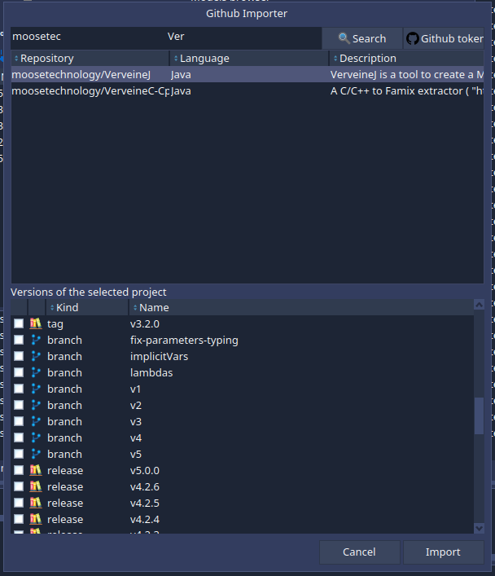
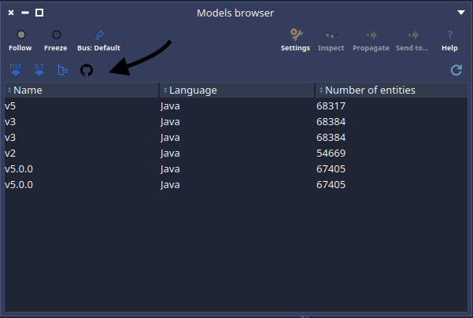

Moose is a platform for software analysis. To analyze a program, Moose needs a model: a **Famix** model that represents the entities and dependencies of the software system. To build this model, the sources have to be imported by an importer. We have several importers depending on the language, but you have to manage the sources yourself: clone the repository, checkout the version you want to analyze, and run the importer on the right folder.

A while ago I did a first little project to import a Java project from a source folder on disk. But most of the time, the code you want to analyze lives on GitHub. So I opened [PR #1658](https://github.com/moosetechnology/MooseIDE/pull/1658) on MooseIDE to add a **GitHub importer** that handles the whole workflow: search, download, import.

<div class="centered-figure">
  
</div>

## Using It

The importer is available from the "Import" toolbar of the Models browser, or from the Moose world menu with the "Github Importer" entry.

<div class="centered-figure">
  
</div>

You enter a part of an organization name and/or a part of a project name, and the importer queries the GitHub search API to list the matching repositories.

When you select a repository, the importer checks its primary language — only Java is supported for now — and lists all the versions you can analyze: **tags, branches, releases, and open pull requests**. Select the ones you want and they are downloaded and imported: you get one Famix model per version, ready in the Models browser.

Analyzing a pull request before reviewing it, or comparing the model of the latest release with the one of the development branch, becomes a two-clicks operation.

## Under the Hood

The whole thing is a new `MooseIDE-Github-Importer` package with three main classes:

- `MiGithubRepository` is the access point to the GitHub API, through Iceberg's `IceGitHubAPI`. It can search for repositories matching a name and an organization, and for a given repository it fetches its primary language and its available versions.
- `MiGithubVersion` represents one version to download: a tag, a branch, a release, or a pull request.
- `MiGithubImporter` does the download and the import. For each selected version, it downloads the source tarball from GitHub, extracts it into a cache directory — `github-moose-cache`, next to the image, with one folder per project and one per version — and parses the folder with VerveineJ through `FamixJavaFoldersImporter`.

The sources are kept on disk so that you can browse the code next to its model.

The download and import can also be done programmatically:

```smalltalk
MiGithubImporter
    downloadAndImport: { MiGithubVersion tagNamed: 'v1.0' }
    from: (MiGithubRepository owner: 'moosetechnology' projectName: 'MooseIDE').
```

The requests are authenticated with the credentials stored for github.com in Iceberg's credential store. Without a token, GitHub allows 60 requests per hour; with a token it goes up to 5000. You can store one from the importer with the "Github token..." button.

## Limitations

It is a first version and it comes with limitations:

- **Java only** for now. The user cannot provide additional import information such as the path of the dependencies or the JDK version.
- The importer relies on the latest version of VerveineJ, so the Famix version of your image needs to match the latest VVJ release.
- **Search** only matches the project name and the organization. More filters could be added later.
- `tar` must be installed on the system to extract the sources.

## What's Next?

Right now, the importer hardcodes that Java projects go through `FamixJavaFoldersImporter`. But Moose has importers for many languages, and each of them might need different information. The idea is to add **pragmas to each Famix importer** to make them discoverable, and let each importer declare which language it handles and which additional information it needs. Toky is already working on a way to detect the importers available in the platform and on a common API, and this importer will plug into it. Once in place, supporting a new language in the GitHub importer should be almost free.

Being able to use another version of VerveineJ than the latest one is also future work. And the [MooseNexus](https://github.com/moosetechnology/MooseNexus) project might help to have a better integration in the future.

In the meantime, if you want to analyze a Java project hosted on GitHub, give it a try and tell me how it goes. Feedback on the [pull request](https://github.com/moosetechnology/MooseIDE/pull/1658) is welcome.
