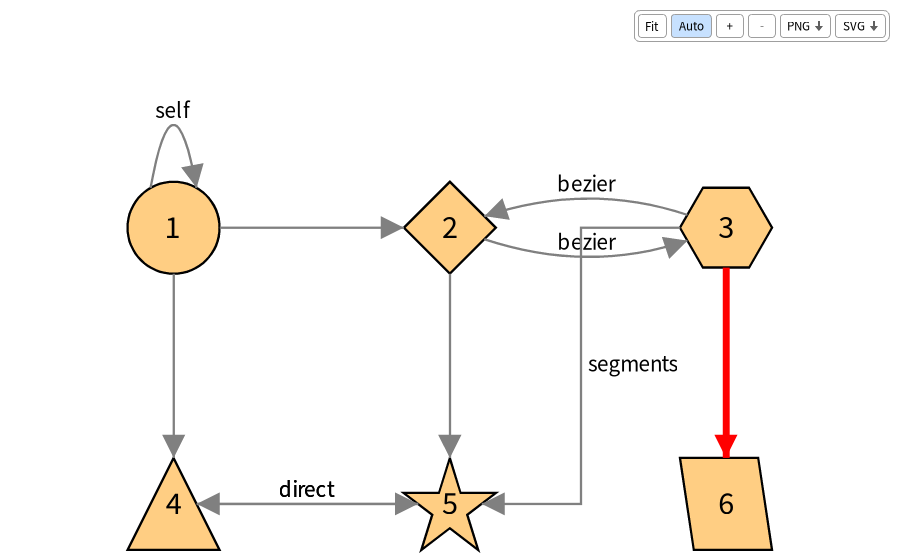
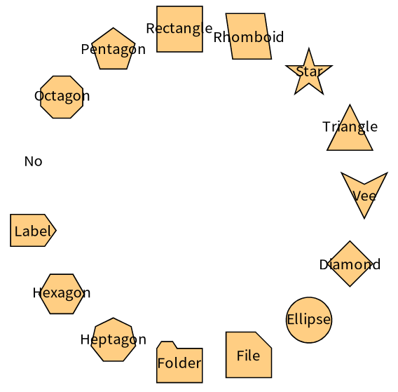
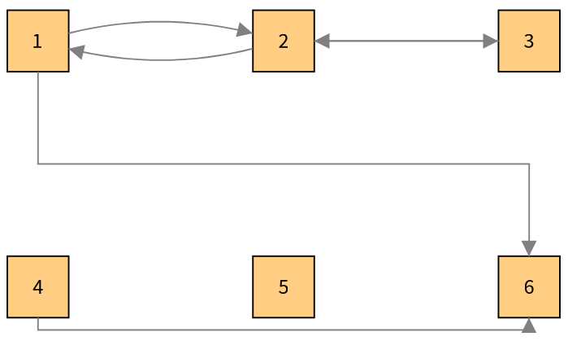
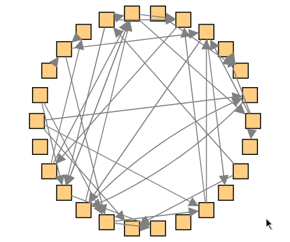
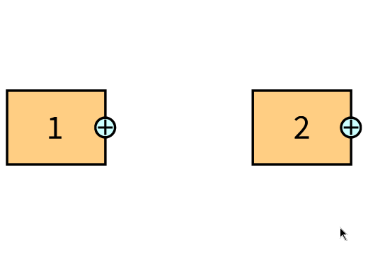
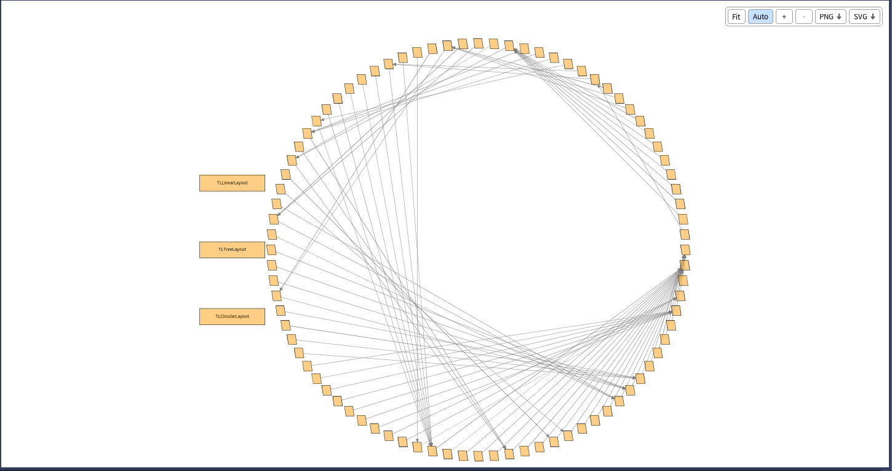
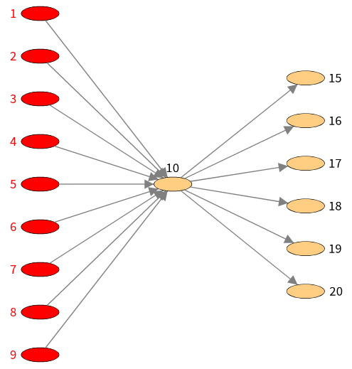

[Telescope](https://github.com/TelescopeSt/Telescope) is an engine to build visualizations. You do not draw anything with it: you describe **nodes**, **groups**, **layouts**, **connections**, **styles**, **interactions** and **legends**, and a *connector* renders this description with a graphical framework. The idea is to concentrate on the problem at hand instead of the nitty-gritty of a drawing library.

The drawback of this design is that Telescope is useless without a connector. The one that exists for the web is the [CytoscapeJs connector](https://github.com/TelescopeSt/TelescopeCytoscape), and a Roassal connector was started but nobody had the time to maintain it. Nothing allowed to use Telescope directly in a Pharo window, with the graphical framework of Pharo itself.

So I wrote [TelescopeBloc](https://github.com/TelescopeSt/TelescopeBloc), a connector which renders Telescope visualizations with [Bloc](https://github.com/pharo-graphics/Bloc).

<div class="centered-figure">
  
</div>

## Using It

You can install it in Pharo 14 or 15 like this:

```smalltalk
Metacello new
    githubUser: 'TelescopeSt' project: 'TelescopeBloc' commitish: 'development' path: 'src';
    baseline: 'TelescopeBloc';
    load
```

Then open the demo browser with `TLBlocDemoPresenter open` and have a look. If something is missing or does not behave like the other connectors, open an issue on the [repository](https://github.com/TelescopeSt/TelescopeBloc).


Once the project is loaded, Telescope uses the connector with the highest priority in the image, so nothing changes in your code:

```smalltalk
visualization := TLVisualization new.
visualization styleSheet nodeLabel: #asString.
visualization addNodesFromEntities: (1 to: 10).
visualization open
```

The window zooms with the mouse wheel, pans when you press on the background, and lets you drag the nodes while the connections follow them. A toolbar fits the visualization to the window, zooms, exports it as a PNG or an SVG, and has an *Auto* toggle which refits the visualization each time a layout moves or adds nodes.

## What Is Supported

The goal was a **complete** connector: everything the Telescope API offers should work in Bloc, so that the same code gives the same result as with any other connector.

- **Nodes**: all the shapes, colors (from the entity, with a block or with a gradient), borders (solid, dashed, dotted and double), sizes computed from the entity, labels with their positions, wrapping and ellipsis, and composite nodes which contain other nodes.
- **Groups and layouts**: all the layouts of Telescope. When a layout is applied again, the nodes slide to their new places instead of jumping.
- **Connections**: curves, direct lines, and segments with right angles. Parallel connections are spread as arcs, a node connected to itself gets a loop, and arrows can be drawn at the start, the middle and the end of a connection.
- **Interactions**: mouse over, click, double click, right click, drop, menus with submenus, pop ups, and the small shape triggers beside a node.
- **Legends**: static entries and entries which follow the node under the mouse.

<div class="image-row">
  
  
</div>

<div class="image-row">
  
  
</div>

When a layout is applied again, the nodes slide to their new places instead of jumping. Here, a click on the name of a layout applies it to the group of classes:

<div class="centered-figure">
  
</div>

The ready-made visualizations of Telescope, such as the butterfly, the flow graph or the distribution map, work out of the box too.

<div class="centered-figure">
  
</div>

## The Demo Browser

Telescope comes with about forty demos. TelescopeBloc has a demo browser, in the world menu under *Telescope*. It lists the demos by readable names, filters them, renders the selected one in a Bloc canvas, and displays its description and its source code below.

## Documentation

While working on the connector I wrote a documentation of the API of Telescope, with a chapter for the nodes, the groups and layouts, the styles, the connections, the composite nodes, the interactions, the legends, the visualization templates and the connectors, illustrated with images and GIFs taken from this connector. You can find it in the [Telescope repository](https://github.com/TelescopeSt/Telescope/tree/development/resources/doc/README.md).

I also noted in the [documentation of Bloc](https://github.com/pharo-graphics/Bloc) what this project taught me: layout and constraints surprises, how mouse events reach the elements, and how to test interactions and take screenshots headless.
