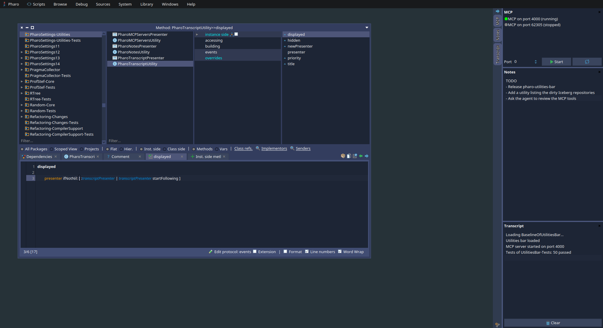
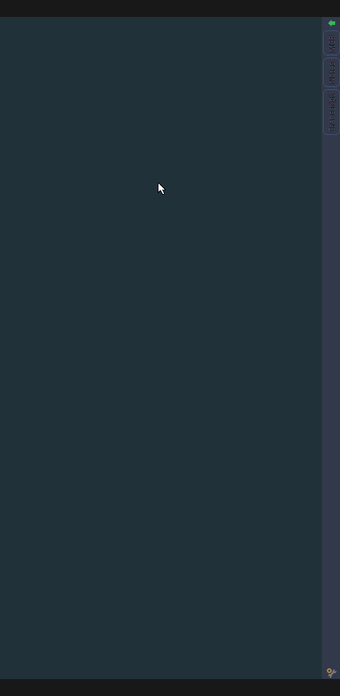
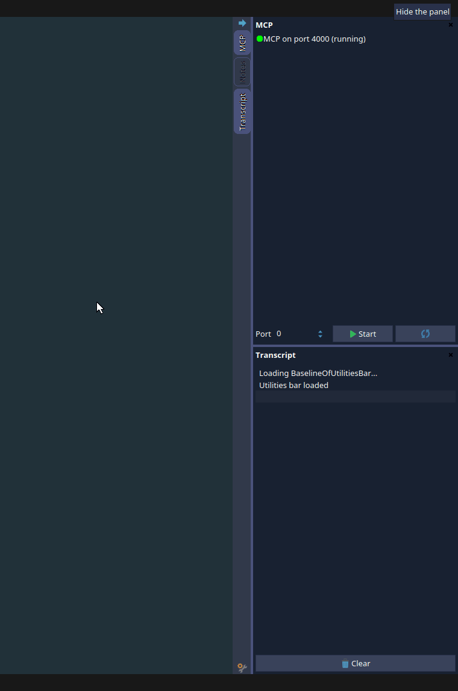
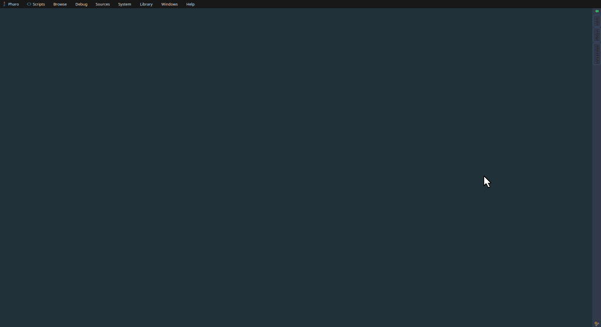
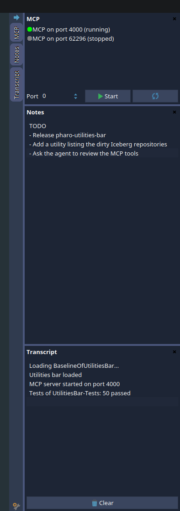

Some tools are not worth a window. I want to know if the MCP server of my image is running, to write a quick note or to glance at the Transcript, but I do not want to look for a window hidden behind ten browsers each time, or to open it again because I closed it.

So I wrote [pharo-utilities-bar](https://github.com/jecisc/pharo-utilities-bar): a bar docked on an edge of the Pharo world, where each utility gets a vertical tab and a panel.

<div class="full-width-figure">
  
</div>

## Installing It

```smalltalk
Metacello new
    githubUser: 'jecisc' project: 'pharo-utilities-bar' commitish: 'main' path: 'src';
    baseline: 'UtilitiesBar';
    load
```

The bar opens on the right edge of the world as soon as it is loaded. It works in Pharo 12 to 15.

## Using It

A tab tells whether its utility is active, and clicking it shows or hides the panel of the utility. Several utilities can be displayed at the same time: their panels are stacked in the order of the tabs. The arrow at the top collapses the whole bar so that only the tabs remain, without forgetting which utilities were active.

The panels can be resized: drag their inner edge to change their width, and the separators between them to share the height. A small utility, such as the status of an MCP server, can stay small while a bigger one takes the rest of the height.

<div class="image-row">
  
  
</div>

The world treats the bar like the taskbar: maximized windows do not cover it. And the layout (active utilities and heights) is kept when the bar is recreated, which happens each time the code of a utility changes.

The settings are in the bar itself, behind the icon at its bottom: show the bar or not, the edge it sticks to, and the width of the panels. They are only applied when clicking *Save*, so unchecking the option showing the bar does not make it vanish under your mouse. The same settings are in the Settings browser, under *Appearance > Morphic > Utilities bar*.

<div class="full-width-figure">
  
</div>

## Writing a Utility

A utility is a subclass of `UtilitiesBarUtility` answering a title and a Spec presenter. There is nothing to register: the bar finds the subclasses and updates itself as soon as a utility is created, changed or removed, so you can develop a utility and see it live.

```smalltalk
UtilitiesBarUtility << #MyUtility
    package: 'MyPackage'

MyUtility >> title
    ^ 'My utility'

MyUtility >> newPresenter
    ^ SpTextPresenter new
        text: 'Hello';
        yourself
```

A utility can also order its tab with `#priority`, answer a Morph instead of a presenter with `#buildContent`, or hide itself with the class side `#isAvailable` when a dependency it needs is missing.

The hooks I like the most are `#displayed` and `#hidden`. The bar sends them when the panel of a utility becomes visible and when it stops being visible: the utility was hidden, or the bar was collapsed or deleted. A utility following a source of updates can listen only while someone looks at it, so a hidden utility costs nothing to the image.

## My Own Utilities

The utilities I use every day live in my [pharo-scripts](https://github.com/jecisc/pharo-scripts), the settings loaded in all my images. They were added in [this commit](https://github.com/jecisc/pharo-scripts/commit/4e68cea8c21825416071b8fc61b92954e9c89c37) if you want a full example.

<div class="centered-figure">
  
</div>

- **MCP** lists the servers of [MCP](https://github.com/Evref-BL/MCP) running in the image with their port and a colored dot: green when the server runs and listens, orange when the server and its socket disagree, gray when it is stopped. A port input and a button start a new server. When MCP is not loaded, the panel only shows a button to load it.
- **Notes** is a text area saved at each change in the cache folder of the playground, which my settings share between all my images. A note taken in one image is there in the next one.
- **Transcript** displays the Transcript. It is the example of `#displayed` and `#hidden`: it only listens to the new entries while its panel is visible.

```smalltalk
PharoTranscriptUtility >> displayed
    presenter ifNotNil: [ :transcriptPresenter | transcriptPresenter startFollowing ]

PharoTranscriptUtility >> hidden
    presenter ifNotNil: [ :transcriptPresenter | transcriptPresenter stopFollowing ]
```

The baseline of my settings loads the bar from my local clone when there is one, so my images do not need the network, and from GitHub otherwise.

## What Is Next

This is a first step: the MCP utility is the one I wanted to manage my MCP servers, and I have other ideas in mind, like a utility listing the Iceberg repositories with uncommitted changes, or one listing the recent changes of the image to review them before committing.

If you write a utility, or if you miss something in the bar, open an issue on the [repository](https://github.com/jecisc/pharo-utilities-bar) or leave a comment below!
